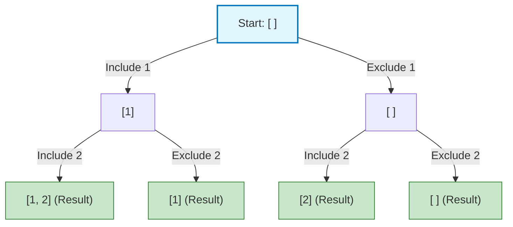

# Backtracking in the Context of Recursion


## 1. Recursion vs. Backtracking

*   **Recursion** is when a function calls itself to solve a smaller piece of a problem. It goes deeper and deeper until it hits a stopping point (called a **Base Case**).
*   **Backtracking** is a *special type* of recursion. It is used when we need to find all possible solutions (combinations, permutations, or paths). 
    *   Imagine you are walking through a maze. 
    *   You choose a path. You hit a dead end (a wall).
    *   Instead of giving up, you take a step back, "undo" your choice, and try a different path. 
    *   That "taking a step back and undoing" is the core of backtracking.

## 2. The FAANG "Golden Template"

In top MNC interviews, almost every backtracking problem can be solved using this exact 3-step pattern. Memorize this!

1.  **Choose:** Pick one option from your available choices.
2.  **Explore (Recurse):** Call the recursive function to move forward with that choice.
3.  **Un-choose (Backtrack):** Undo the choice you just made so you can try the next option.

## 3. Visualizing the Decision Tree (State-Space Tree)

When we do backtracking, we are secretly building a tree in the computer's memory. Let's say we want to find all subsets of the array `[1, 2]`. 

At each step, we have two choices for every number: **Include** it, or **Exclude** it.



Notice how if we go down to `[1, 2]`, we have to **backtrack** up to `[1]` so we can try the "Exclude 2" path!

## 4. Java Code Example: Subsets

This is a very common beginner FAANG question. We will use Java `ArrayList` and apply our Golden Template. Read the comments carefully; they are the most important part.

```java
import java.util.ArrayList;
import java.util.List;

public class BacktrackingMasterclass {

    // 1. The main function that an interviewer will call
    public List<List<Integer>> subsets(int[] nums) {
        List<List<Integer>> result = new ArrayList<>();
        // Start the recursion with an empty current subset at index 0
        generateSubsets(nums, 0, new ArrayList<>(), result);
        return result;
    }

    // 2. The Backtracking (Recursive) Helper Function
    private void generateSubsets(int[] nums, int index, List<Integer> currentSubset, List<List<Integer>> result) {
        
        // BASE CASE: If we have made a decision for every number in the array
        if (index == nums.length) {
            // We must add a COPY of the list, not the reference itself!
            result.add(new ArrayList<>(currentSubset));
            return;
        }

        // --- THE GOLDEN TEMPLATE ---

        // STEP 1: CHOOSE
        // Let's decide to INCLUDE the current number
        currentSubset.add(nums[index]);
        
        // STEP 2: EXPLORE (Recurse)
        // Move to the next index
        generateSubsets(nums, index + 1, currentSubset, result);
        
        // STEP 3: UN-CHOOSE (Backtrack)
        // We hit a base case and returned. Now we must UNDO our choice.
        // We remove the number we just added. This is the "Backtrack"!
        currentSubset.remove(currentSubset.size() - 1);


        // NOW, we explore the alternate reality where we EXCLUDE the current number.
        // Since we just removed the number above, our list is clean.
        generateSubsets(nums, index + 1, currentSubset, result);
    }
}
```

## 5. What Interviewers Care About: Complexity Analysis

In a Microsoft or Google interview, your code is only half the battle. You must explain how much Time and Space your algorithm takes using Big O notation.

*   **Time Complexity:** $O(2^N)$
    *   **Why?** Because for every element ($N$ elements total), you have exactly $2$ choices: Include or Exclude. So the tree branches out $2 \times 2 \times 2...$ which is $2^N$. Backtracking is naturally slow!
*   **Space Complexity:** $O(N)$
    *   **Why?** $N$ is the number of elements. This is the maximum depth of the recursion tree. The computer uses the Call Stack to remember the recursive function calls, taking up $O(N)$ memory.

## Summary Checklist
1. Did you write a Base Case?
2. Did you Choose, Recurse, and Un-choose?
3. Did you add a *copy* of your object to the result list? (e.g., `new ArrayList<>(currentSubset)`)