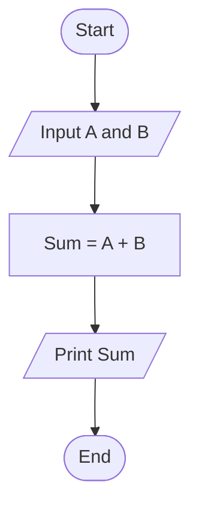
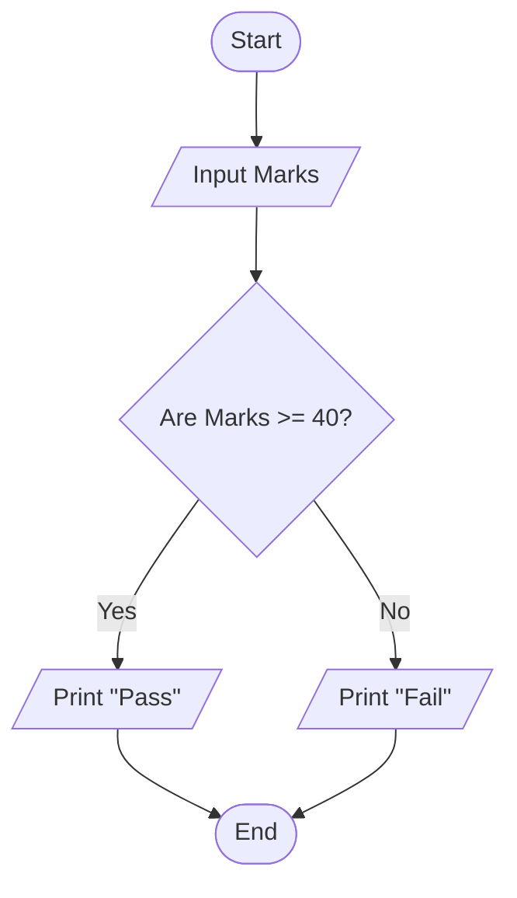
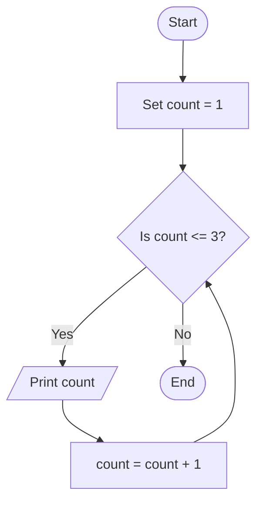
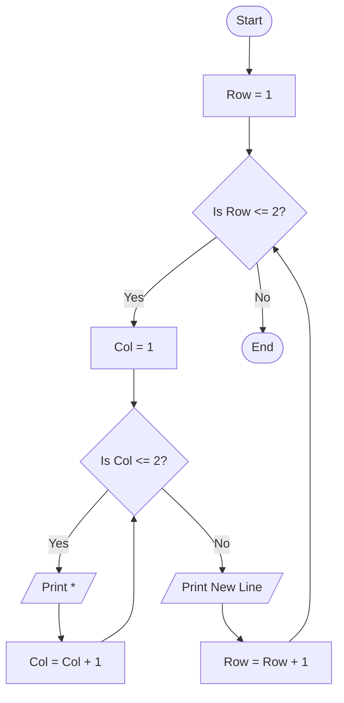

# The 4 Core Patterns of Flowcharts and Algorithms
 **no matter how complex an algorithm gets at top MNCs, it is always built using these four fundamental patterns.** 

Let's master them one by one, using simple English, clear visuals, and Java code.

---

## 1. The Sequential Pattern (Step-by-Step)

The sequential pattern is the most basic flow. It means executing tasks in a straight line, from top to bottom, one after the other. There are no skips and no jumps.

### When to use it:
When you need to do straightforward calculations or operations where every step must happen exactly once. 

### Visual Flowchart: Adding Two Numbers


### Java Code Example:
Notice how the code goes straight down, exactly like the arrows in the diagram.
```java
public class SequentialExample {
    public static void main(String[] args) {
        // Step 1: Input (Hardcoded for simplicity)
        int a = 10;
        int b = 20;
        
        // Step 2: Process
        int sum = a + b;
        
        // Step 3: Output
        System.out.println("The sum is: " + sum);
    }
}
```

---

## 2. The Conditional Pattern (Branching)

Real-world problems require decisions. The conditional pattern creates a "fork in the road." Depending on a question (True/False), the program takes one path and ignores the other. 

### When to use it:
When your logic needs to handle different situations. For example, validating if a user has a valid password, or checking if a number is positive or negative.

### Visual Flowchart: Checking Pass or Fail


### Java Code Example:
In Java, we use the `if-else` statement to create this diamond shape.
```java
public class ConditionalExample {
    public static void main(String[] args) {
        int marks = 35; // Input
        
        // Decision Diamond
        if (marks >= 40) {
            System.out.println("Pass"); // True path
        } else {
            System.out.println("Fail"); // False path
        }
    }
}
```

---

## 3. The Loop Pattern (Iteration/Repetition)

Top companies love efficiency. Instead of writing the same code 100 times, we use a loop. A loop pattern executes a block of code repeatedly as long as a condition is True. Once it becomes False, the loop breaks.

### When to use it:
Whenever you need to process lists of data, count numbers, or search through an array.

### Visual Flowchart: Print 1 to 3


### Java Code Example:
In Java, this is represented by `while` or `for` loops.
```java
public class LoopExample {
    public static void main(String[] args) {
        int count = 1; // Initialization
        
        // The condition that keeps the loop running
        while (count <= 3) {
            System.out.println(count);
            count++; // Process: Increase count by 1
        }
        // When count becomes 4, the loop stops.
    }
}
```

---

## 4. Nested Design (Patterns inside Patterns)

Now we reach the MNC level! A nested design is when you put one pattern **inside** another. For example, an `if` condition inside another `if`, or a `loop` inside another `loop`. 

### When to use it:
Complex data structures. A very common Google interview question involves traversing a 2D matrix (like a chessboard or a spreadsheet). To read a grid, you need a loop (for rows) and another loop inside it (for columns).

### Visual Flowchart: A Loop Inside a Loop (Nested Loops)
Let's print a 2x2 grid of stars (`*`). 
* The **Outer Loop** controls the rows.
* The **Inner Loop** controls the columns.



### Java Code Example:
```java
public class NestedExample {
    public static void main(String[] args) {
        // Outer loop for Rows (1 to 2)
        for (int row = 1; row <= 2; row++) {
            
            // Inner loop for Columns (1 to 2)
            for (int col = 1; col <= 2; col++) {
                System.out.print("* "); // Print on the same line
            }
            
            // Move to the next line after inner loop finishes
            System.out.println(); 
        }
    }
}
```
**Output of this code:**
```text
* * 
* * 
```

---

## Summary for Your Interview Prep
When a Facebook or Microsoft interviewer gives you a problem:
1. Try to see if it's a simple sequence.
2. Figure out where the decisions (conditions) are.
3. Ask yourself: "Do I need to repeat anything?" (Loop).
4. Ask yourself: "Do I need to loop through something *while* I am already inside a loop?" (Nested). 

Mastering these four patterns means you can mentally design a flowchart for ANY coding problem!