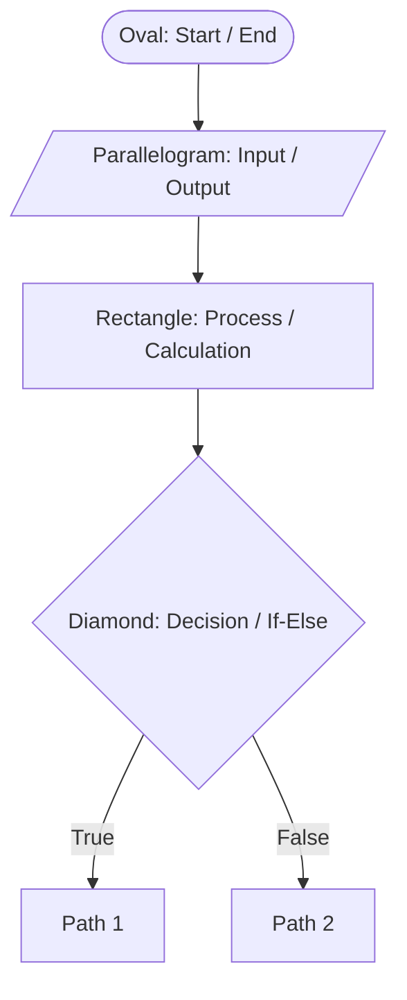
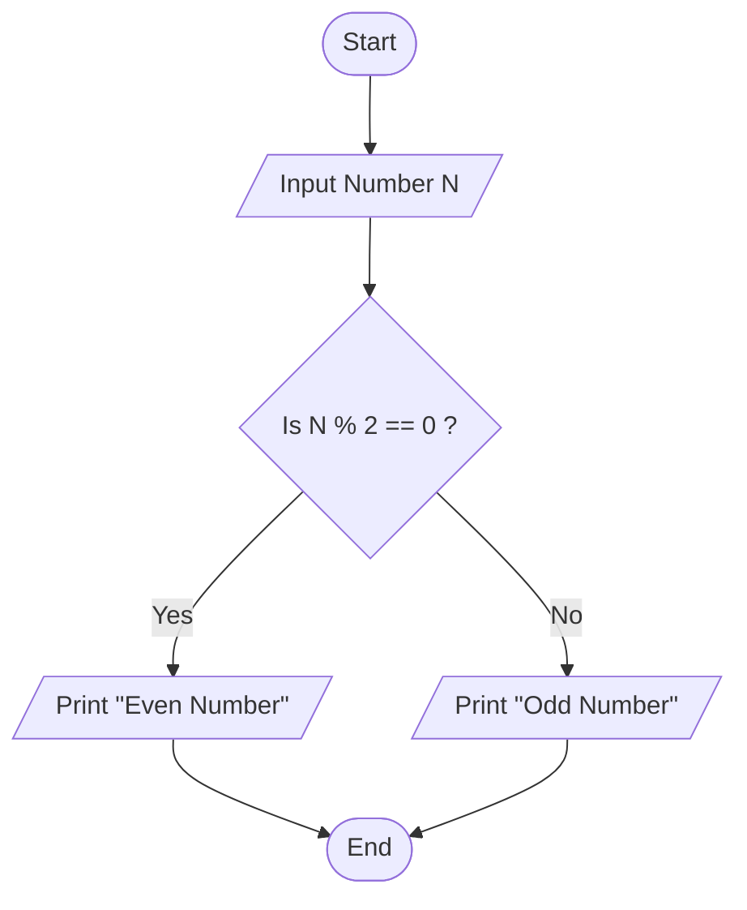
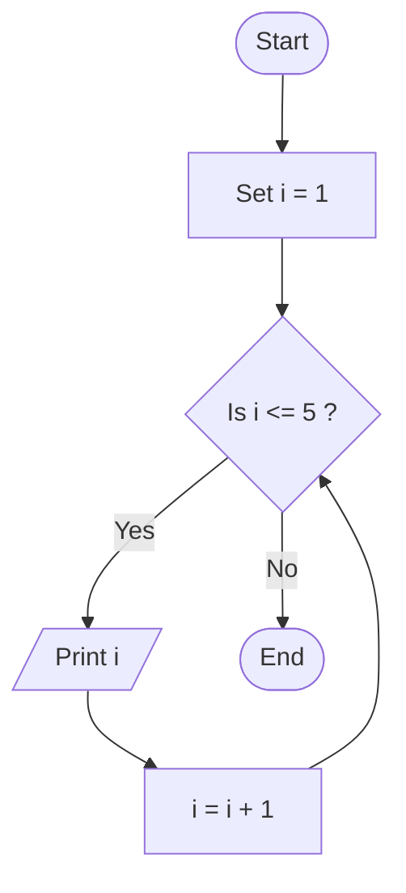

# Mastering Flowcharts: The Blueprint of Algorithms


## What is a Flowchart?
A flowchart is a **visual representation of an algorithm**. It shows the step-by-step process of solving a problem using different shapes connected by arrows. Think of it as a map that guides your data from the start of a program to the end.

## The Standard Symbols You Must Know
To draw a flowchart, we use universal symbols. No matter what programming language you use, these shapes mean exactly the same thing.



Here is the breakdown of the most important shapes:

1. **Oval (Terminal):** Used to represent the `Start` or `End` of a program.
2. **Parallelogram (Input/Output):** Used whenever you are taking data from the user or printing data to the screen (e.g., `System.out.println` in Java).
3. **Rectangle (Process):** Used for calculations, variable assignments, or any operations (e.g., `sum = a + b`).
4. **Diamond (Decision):** The most important shape for logic! Used for conditions like `if-else` or loops. It asks a Yes/No (True/False) question, and the flow splits into two paths based on the answer.
5. **Arrows (Flow lines):** Connect the shapes and show the direction of the logic.

---

## Example 1: The Decision Maker (Even or Odd)
Let's design a flowchart and write the Java code for a simple problem: **Check if a given number is Even or Odd.**

### The Visual Flowchart



### The Java Code
Here is how that exact visual flow translates into Java code:

```java
public class EvenOdd {
    public static void main(String[] args) {
        // [Parallelogram] Input data
        int n = 10; 
        
        // [Diamond] Decision block
        if (n % 2 == 0) {
            // [Parallelogram] True path output
            System.out.println("Even Number"); 
        } else {
            // [Parallelogram] False path output
            System.out.println("Odd Number"); 
        }
        // [Oval] End of program
    }
}
```

---

## Example 2: The Loop (Print numbers 1 to 5)
In interviews at companies like Microsoft, you will deal heavily with loops (doing something repeatedly). Let's see how a flowchart handles loops.

### The Visual Flowchart



### The Java Code

```java
public class PrintNumbers {
    public static void main(String[] args) {
        // [Rectangle] Initialization (Process)
        int i = 1; 
        
        // [Diamond] Loop condition
        while (i <= 5) {
            // [Parallelogram] Output
            System.out.println(i); 
            
            // [Rectangle] Process/Increment
            i++; // Same as i = i + 1
        }
        // [Oval] End
    }
}
```

---

## Why Top MNCs Care About This
If you interview at Google, the interviewer will give you a very hard problem. If you start typing Java code immediately, **you will fail**. 

They want to see you:
1. Break down the problem logically.
2. Draw the flow (even mentally or on a whiteboard).
3. Identify edge cases (what if the input is negative? what if it's zero?) at the decision diamonds.
4. *Only then* convert it to code.

Flowcharts force you to think about **Control Flow**—how your program jumps from one instruction to another.

## Related Topics to Explore Next
Since you are mastering flowcharts, these are the related concepts you will learn next in our journey:
* **Pseudocode:** Writing the algorithm in plain English (a step between a flowchart and actual Java code).
* **Control Statements:** The actual Java tools (`if`, `else`, `switch`, `for`, `while`) used to build the diamonds in our flowcharts.
* **Dry Running:** Manually tracing a flowchart step-by-step with a pen and paper to find bugs before running the code.