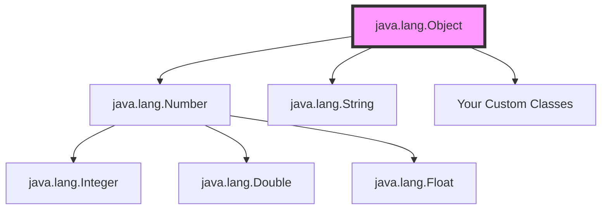
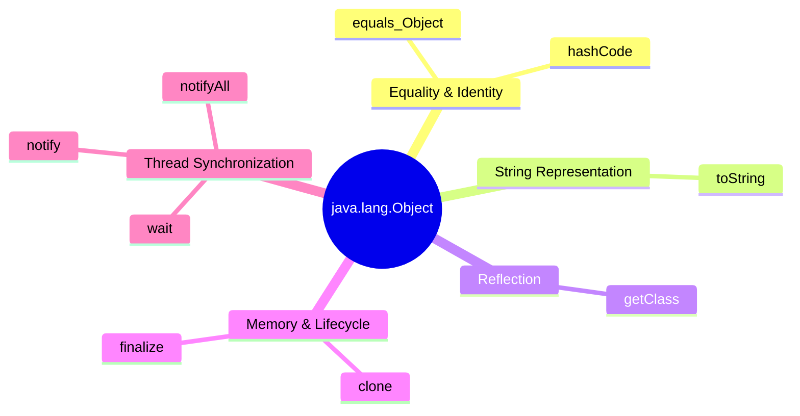

# The `java.lang.Object` Class in Java


Every single class you create or use in Java has a secret, invisible parent: the `Object` class. Located in the `java.lang` package, it is the root of the class hierarchy. Think of it as the "Adam and Eve" of Java. If a class doesn't explicitly extend (inherit from) another class, Java automatically makes it a child of `Object`.

This means **every object in Java inherits a specific set of tools (methods)**. Java's creators did this so that all objects, whether they represent a `Car`, a `BankAccount`, or a `String`, share a common baseline behavior—like the ability to be compared, converted to text, or managed in memory.

Look at how the built-in `Number` class (and its children like `Integer` and `Double`) ultimately trace their roots back to the `Object` class:



---

## 1. The "Everyday" Methods
These are the methods you will use and override the most in your daily programming.

### `public String toString()`
* **What it does:** Returns a string (text) representation of the object. It acts like a "name tag" for your object.
* **Default behavior:** It prints the class name, an `@` symbol, and a random-looking memory code (e.g., `Student@15db9742`).
* **Best Practice:** Always override this method in your classes to print meaningful information instead of gibberish.

**Example Code:**
```java
class Student {
    String name;
    
    Student(String name) {
        this.name = name;
    }

    // Overriding toString to give a meaningful output
    @Override
    public String toString() {
        return "Student Name: " + this.name;
    }
}

public class Main {
    public static void main(String[] args) {
        Student s1 = new Student("Alice");
        // Automatically calls s1.toString() when you try to print the object
        System.out.println(s1); 
        // Output: Student Name: Alice
    }
}
```

### `public boolean equals(Object obj)`
* **What it does:** Compares two objects to see if they are "equal."
* **Default behavior:** It only returns `true` if both variables point to the exact same memory location (like two people sharing the exact same physical body).
* **Best Practice:** Override this to compare the *actual data* inside the objects (like checking if two books have the same title).

**Example Code:**
```java
class Book {
    String title;
    
    Book(String title) { this.title = title; }

    @Override
    public boolean equals(Object obj) {
        // 1. If it's the exact same object in memory, they are equal
        if (this == obj) return true;
        
        // 2. If the other object is null or a different class, not equal
        if (obj == null || this.getClass() != obj.getClass()) return false;
        
        // 3. Compare the actual data
        Book otherBook = (Book) obj;
        return this.title.equals(otherBook.title);
    }
}
```

### `public int hashCode()`
* **What it does:** Returns a unique integer (a "hash code") for the object. Think of it as assigning the object to a specific numbered locker.
* **The Golden Rule:** If you override `equals()`, you **must** override `hashCode()`. If two objects are equal according to `equals()`, they must have the same hash code. This is crucial when storing objects in collections like `HashMap`.

---

## 2. The Reflection Method
Reflection in Java is the ability of a program to examine its own structure while running.

### `public final Class<?> getClass()`
* **What it does:** Returns the runtime class (the blueprint) of the object. You cannot override this method because it is marked `final`.
* **Usage:** Used to find out exactly what type of object you are dealing with while the program is running.

**Example Code:**
```java
String text = "Hello";
Class c = text.getClass();
System.out.println(c.getName()); 
// Output: java.lang.String
```

---

## 3. The Lifecycle & Duplication Methods

### `protected Object clone() throws CloneNotSupportedException`
* **What it does:** Creates and returns a copy of the object. 
* **The Catch:** To use it, your class must implement the `Cloneable` interface. It performs a "shallow copy," meaning it copies the immediate values, but if your object contains other complex objects, it only copies their memory addresses.

### `protected void finalize() throws Throwable`
* **What it does:** This is a hook for the Garbage Collector (Java's automatic memory cleaner). Right before Java destroys an unused object to free up memory, it calls this method.
* **Important Note:** This method is **deprecated** (outdated and not recommended to use) in modern Java because you never know exactly *when* the garbage collector will run. 

---

## 4. The Threading Methods (Wait & Notify)
Java allows multiple "threads" (independent paths of execution) to run at the same time. Think of threads as workers sharing a single room (the object). These methods coordinate the workers. They are `final` and cannot be overridden.

* **`public final void wait()`**: Tells the current worker (thread) to pause, give up the key to the room, and go to sleep until another worker wakes them up.
* **`public final void notify()`**: Wakes up one single worker who is currently sleeping on this object.
* **`public final void notifyAll()`**: Wakes up *all* workers who are sleeping on this object.

---

## Visual Summary: The 11 Inherited Methods

Here is a visual map of the 11 methods every single Java object possesses. You can view this hierarchy broken down into logical groups:



*Note: In the diagram above, `wait` actually has 3 overloaded versions in Java: `wait()`, `wait(long timeout)`, and `wait(long timeout, int nanos)`, making up the total of 11 methods!*