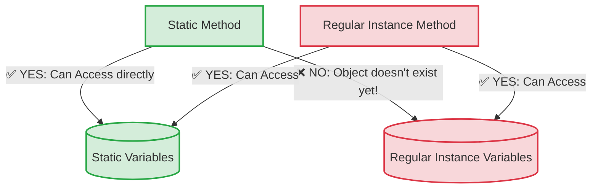

# Master the `static` Keyword in Java

 we are going to learn one of the most important concepts in Java: the **`static`** keyword. 

In simple English: **`static` means "belongs to the whole Class, not to a specific Object."**

Whenever you use the word `static`, Java does it for **memory management**. It saves memory by sharing one single copy of something across everything.

Let's break this down into four main parts:
1. Static Variables
2. Static Methods
3. Static Blocks
4. Static Classes

---

## 1. Static Variables (Shared Memory)

Normally, when you create an object (like a specific Student), every object gets its own copy of variables (like `name` or `age`). These are called *instance variables*.

But what if all students go to the same college? If we create 1000 students, repeating the college name 1000 times wastes memory. This is where `static` helps.

A **static variable** is created only **once** in the memory and is **shared** by all objects of that class.
---
## Visual : The "Water Cooler" Analogy (Variables)

When you create regular variables, every object gets its own copy (like a coffee cup). When you create a `static` variable, everyone shares the same one (like an office water cooler).

### ASCII Illustration:

```text
       [ THE CLASS LEVEL (Shared by everyone) ]
       
            [💧 WATER COOLER (static String college = "MIT") ]
                           ^      ^      ^
                           |      |      | (Everyone drinks from the same cooler)
      +--------------------+      |      +--------------------+
      |                           |                           |
[ STUDENT 1 ]               [ STUDENT 2 ]               [ STUDENT 3 ]
☕ Cup: name="John"         ☕ Cup: name="Emma"         ☕ Cup: name="Raj"
☕ Cup: age=20              ☕ Cup: age=21              ☕ Cup: age=22
(Instance Vars)             (Instance Vars)             (Instance Vars)
```

**Takeaway:** If John changes the water cooler label from "MIT" to "Harvard", Emma and Raj will instantly see "Harvard" when they look at the cooler.

---

### Analogy: The Office Water Cooler
* **Instance Variable:** Your personal coffee mug. Everyone has their own. If your mug is empty, your friend's mug might still be full.
* **Static Variable:** The office water cooler. There is only ONE water cooler. If one person empties it, it is empty for everyone.

### Visual Diagram (Memory Layout)
```text
  CLASS MEMORY AREA (Shared)           HEAP MEMORY AREA (Objects)
+-------------------------------+   +-------------------------------+
| Class: Student                |   | Object 1 (Student)            |
|                               |   |  name: "John"                 |
| static String college = "MIT" |<--|  age: 20                      |
|                               |   |                               |
+-------------------------------+   +-------------------------------+
                                    | Object 2 (Student)            |
                                    |  name: "Emma"                 |
                                    |  age: 21                      |
                                    +-------------------------------+
```
*Notice how both John and Emma share the exact same `college` variable.*

### Code Example:
```java
class Student {
    // Instance variables (unique to each student)
    String name;
    
    // Static variable (shared by ALL students)
    static String college = "MIT"; 

    // Constructor
    Student(String n) {
        name = n;
    }
}

public class Main {
    public static void main(String[] args) {
        Student s1 = new Student("John");
        Student s2 = new Student("Emma");

        // We can access static variables using the Class Name directly!
        System.out.println(s1.name + " studies at " + Student.college);
        System.out.println(s2.name + " studies at " + Student.college);
        
        // If we change it, it changes for EVERYONE
        Student.college = "Harvard";
        System.out.println("College changed!");
        
        System.out.println(s1.name + " now studies at " + Student.college);
    }
}
```

---

## 2. Static Methods

A **static method** is a method that belongs to the Class, not the object. 
The biggest advantage? **You don't need to create an object to use a static method.** You just use the class name.

### Golden Rules of Static Methods:
1. A static method can **only directly access other static variables and static methods**. It cannot touch instance (non-static) variables. Why? Because non-static variables need an object to exist, and static methods don't care about objects!
2. You cannot use the words `this` or `super` inside a static method.

## Visual 3: The "Who Can Talk to Who?" Flowchart (Methods)

One of the biggest errors beginners make is trying to use a regular variable inside a `static` method. Think of `static` as a strict VIP club.

### Access Rules Diagram:



*(Note: If your markdown reader supports Mermaid, you will see a flowchart above! If not, see the text version below).*

### Why is `main` method static?
`public static void main(String[] args)`
Java makes the `main` method static so the JVM (Java Virtual Machine) can run your program without having to create an object of your main class first!

### Code Example:
```java
class MathHelper {
    // Non-static variable
    int normalNumber = 10;
    
    // Static variable
    static int staticNumber = 50;

    // Static Method
    static void calculateSum(int a, int b) {
        System.out.println("Sum is: " + (a + b));
        
        // System.out.println(normalNumber); // ERROR! Cannot use non-static here.
        System.out.println(staticNumber); // Allowed!
    }
}

public class Main {
    public static void main(String[] args) {
        // Look! No "new MathHelper()" is needed. 
        // We call it directly using the Class name.
        MathHelper.calculateSum(10, 20); 
    }
}
```
### Text Version of Access Rules:
*   🟢 **Static Method** ➔ *can use* ➔ **Static Variables** (YES!)
*   🔴 **Static Method** ➔ *can use* ➔ **Instance Variables** (NO! Error!)
*   🟢 **Regular Method** ➔ *can use* ➔ **Instance Variables** (YES!)
*   🟢 **Regular Method** ➔ *can use* ➔ **Static Variables** (YES! Regular methods have full access to everything).

---


## 3. Static Blocks

A **static block** is a special block of code that is used to set up or initialize static variables. 

### When does it run?
It runs exactly **once**, the very first time the class is loaded into memory by Java. It runs **even before the `main` method** and before any objects are created!

### Analogy:
Think of it like opening up a restaurant. Before you can serve any customers (objects) or run the business (`main` method), you must first turn on the main electricity switch for the building. The static block is that "turn on the electricity" step.

### Code Example:
```java
class MyClass {
    static int codeCounter;

    // This is a static block
    static {
        System.out.println("1. Static Block is running!");
        codeCounter = 1000; // Doing complex setup here
    }

    // Constructor
    MyClass() {
        System.out.println("3. Constructor is running!");
    }
}

public class Main {
    public static void main(String[] args) {
        System.out.println("2. Main Method is running!");
        
        MyClass obj1 = new MyClass(); // Now constructor runs
    }
}
```
**Output of the above code:**
1. Static Block is running! *(Runs as soon as MyClass is touched)*
2. Main Method is running!
3. Constructor is running!

---

## 4. Static Classes (Nested Classes)

In Java, an outer class (a normal top-level class) **cannot** be static. 
However, if you have a class *inside* another class (a Nested Class), that inner class **can** be static.

If a nested class is static, it means you can create an object of the inner class without needing an object of the outer class.

### Code Example:
```java
class OuterClass {
    static int outerData = 100;

    // Static Nested Class
    static class StaticInnerClass {
        void display() {
            System.out.println("Outer data is: " + outerData);
        }
    }
}

public class Main {
    public static void main(String[] args) {
        // Notice we don't need "new OuterClass()" first.
        // We create the inner class object directly.
        OuterClass.StaticInnerClass innerObject = new OuterClass.StaticInnerClass();
        
        innerObject.display();
    }
}
```

---

## Quick Summary for Beginners

| Feature | What does it do? | How do you call it? |
| :--- | :--- | :--- |
| **Static Variable** | Memory shared across all objects. One copy only. | `ClassName.variableName` |
| **Static Method** | Belongs to class. Can't access non-static stuff. | `ClassName.methodName()` |
| **Static Block** | Runs once when class loads. Used for setup. | Runs automatically. |
| **Static Class** | Only for nested classes. Groups related classes. | `new OuterClass.InnerClass()` |

## Final Quick-Glance Summary

Print this out or keep it on your screen when you code:

| If I write... | What does Java do? |
| :--- | :--- |
| `int age = 10;` | Creates a new `age` for **every** single object. |
| `static int age = 10;` | Creates **one** `age` and puts it in the Metaspace room for everyone to share. |
| `void speak()` | Needs an object to work. (`myDog.speak();`) |
| `static void speak()` | Works directly from the class! (`Dog.speak();`) |
| `static { ... }` | Runs **once** automatically before anything else happens. |

