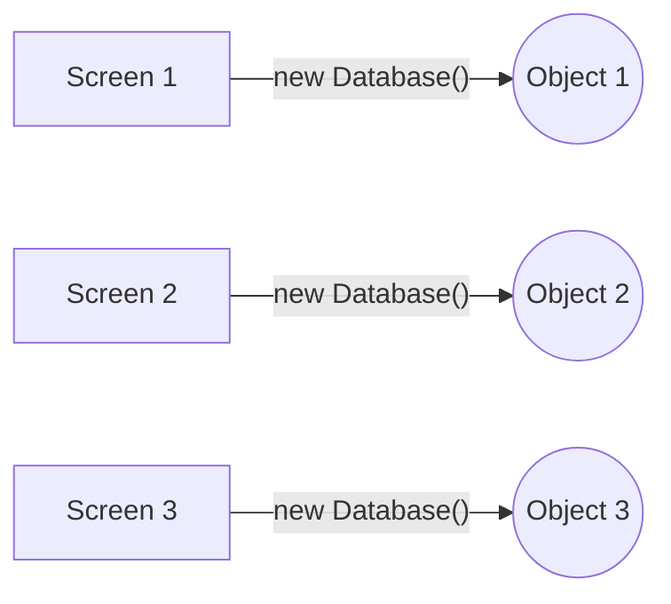
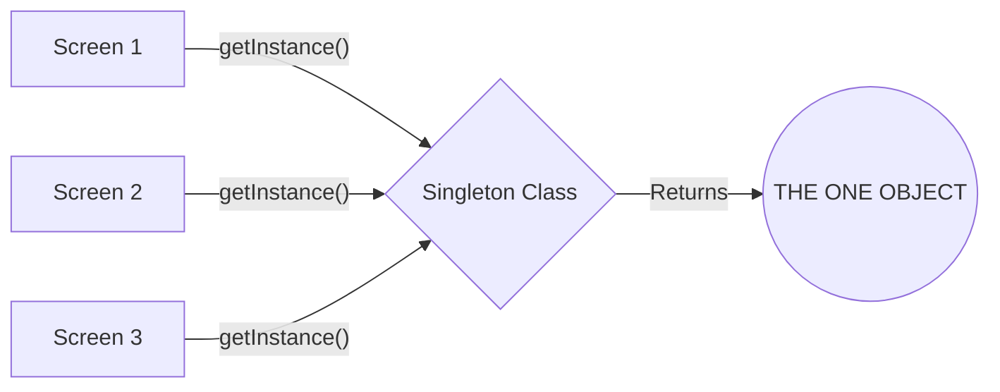
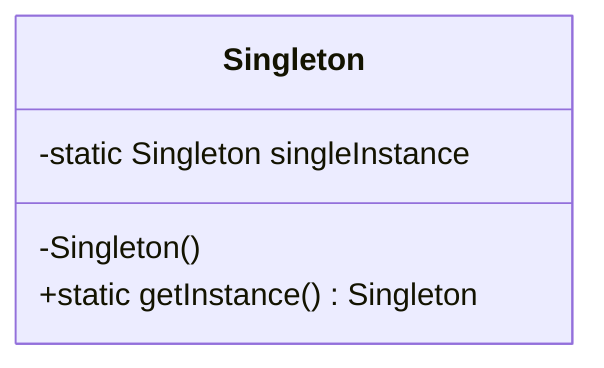
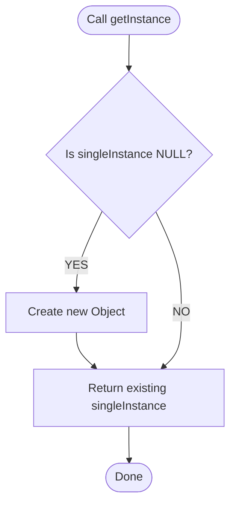

# Master the Singleton Class in Java

## 1. What is a Singleton Class?

In Java, a **Singleton** is a class that allows only **ONE single object (or instance)** of itself to be created during the entire execution of your program.

### A Real-World Analogy 🏛️

Imagine a country's government. A country can have millions of citizens, but it only has **one Prime Minister**.

* If the Education Minister wants to talk to the Prime Minister, they go to that one person.
* If the Defense Minister wants to talk to the Prime Minister, they go to the *exact same* person.

No one is allowed to just "create a new Prime Minister" whenever they want. A Singleton class does exactly this in your code!

---

## 2. Why Do We Need It? (Visualized)

You might wonder, "Why not just create new objects whenever I need them?"

1. **Saving Memory:** If an object does the exact same job everywhere (like connecting to a database), creating 100 copies of it wastes computer RAM.
2. **Shared Data:** If everyone looks at the exact same object, they all share the exact same data.

### ❌ The "Normal" Way (Wasting Memory)
Every time a screen asks for a new object, Java builds a brand new one in memory.



### ✅ The Singleton Way (Smart & Efficient)
Everyone asks the class for the object. The class hands everyone the **exact same object**.



---

## 3. The 3 Golden Rules (The Secret Formula)

To create a Singleton class, you must forcefully stop other programmers from using the `new` keyword. 

Here is the blueprint (Class Diagram) of a Singleton:



**The 3 Rules Explained:**
1. **Private Constructor (`-Singleton()`):** Make the constructor `private`. This acts as a lock. Nobody outside the class can say `new MyClass()`.
2. **Private Static Variable (`-singleInstance`):** Create a `private static` variable inside the class to hold your one single object.
3. **Public Static Method (`+getInstance()`):** Create a `public static` method. This is the only "door" that lets people get your object.

---

## 4. Coding the Singleton

Let's look at the two most common ways to code this.

### Way 1: Eager Initialization (The Easiest Way)

"Eager" means we create the object right away, as soon as the program starts.

```java
public class EagerSingleton {

    // Rule 2: Create the single instance immediately.
    private static EagerSingleton singleInstance = new EagerSingleton();

    // Rule 1: Private constructor stops others from using 'new'.
    private EagerSingleton() {
        System.out.println("Eager Singleton object created!");
    }

    // Rule 3: Provide a public method to get the instance.
    public static EagerSingleton getInstance() {
        return singleInstance;
    }
}
```

### Way 2: Lazy Initialization (The Smarter Way)

"Lazy" means we are lazy! We only create the object if someone actually asks for it. This saves memory if the object is never used.



```java
public class LazySingleton {

    // Rule 2: Start with null. Do not create it yet.
    private static LazySingleton singleInstance = null;

    // Rule 1: Private constructor.
    private LazySingleton() {
        System.out.println("Lazy Singleton object created!");
    }

    // Rule 3: Create it ONLY when asked for the first time.
    public static LazySingleton getInstance() {
        if (singleInstance == null) {
            // First time someone asked! Let's create it.
            singleInstance = new LazySingleton();
        }
        // Return the one and only instance.
        return singleInstance;
    }
}
```

---

## 5. How to Test Your Singleton

Here is how you will use the class we just made.

```java
public class Main {
    public static void main(String[] args) {
        
        // This will give an ERROR because the constructor is private:
        // LazySingleton obj = new LazySingleton(); 
        
        // Correct way: Ask the class for the instance
        LazySingleton object1 = LazySingleton.getInstance();
        LazySingleton object2 = LazySingleton.getInstance();
        
        // Let's check if they are the exact same object in memory
        if (object1 == object2) {
            System.out.println("Success! Both variables point to the exact same object in memory.");
        }
    }
}
```

---

## 6. Bonus Pro-Tip: Thread Safety

*Because I want you to think like a senior developer, here is a slightly advanced concept explained simply.*

In big applications, multiple tasks might happen at the exact same millisecond (this is called **multi-threading**).
If two tasks call our Lazy `getInstance()` at the *exact* same time, they might both see that `singleInstance == null` and accidentally create **two** objects!

To fix this, we use a magic keyword called `synchronized`. It puts a lock on the method, meaning only one task can go inside at a time.

```java
// Thread-Safe Lazy Singleton
public static synchronized LazySingleton getInstance() {
    if (singleInstance == null) {
        singleInstance = new LazySingleton();
    }
    return singleInstance;
}
```

---

## Summary Checklist for Beginners

- [x] **Singleton** = Only one object exists in RAM.
- [x] Constructor must be `private`.
- [x] Variable holding the object must be `private static`.
- [x] You need a `public static` method to share the object.
- [x] Used to save memory and share data (like Database connections or App Settings).