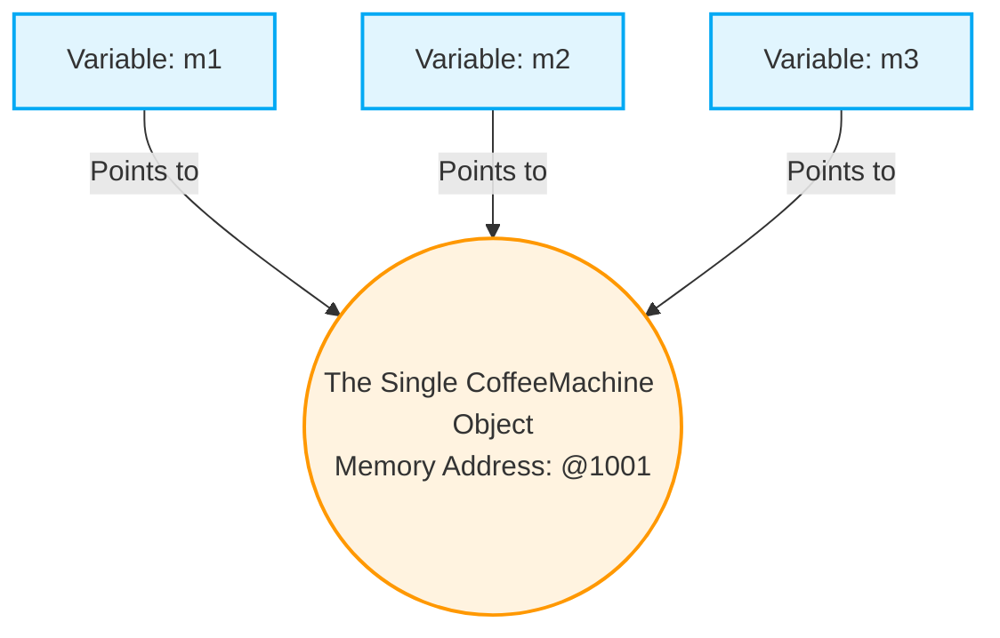

```
// class can create only one object ...
// more than one object is not allowed ...

class CoffeeMachine{
  private  float coffeeQty;
  private  float waterQty;
  private  float MilkQty;
  private  float sugarQty;

  static private CoffeeMachine my = null;

  private  CoffeeMachine(){
    coffeeQty = 1; 
    waterQty = 1; 
    sugarQty = 1; 
    MilkQty = 1; 
  }

   public  void fillWater(float qty){
    waterQty = qty;
   }
   public  void fillMilk(float qty){
    MilkQty = qty;
   }
   public void fillSugar(float qty){
    sugarQty = qty;
   }
   public  float getCoffee(){
    return  0.25f;
   }

  static public  CoffeeMachine getInstance(){
    if (my == null){
      my = new CoffeeMachine();
    }
    return  my;
  }
}

public class Singleton{
 public static  void main(String args []){
  CoffeeMachine m1= CoffeeMachine.getInstance();
  CoffeeMachine m2= CoffeeMachine.getInstance();
  CoffeeMachine m3= CoffeeMachine.getInstance();

  System.out.println(m1+" "+m2+" "+m3);
  if(m1==m2 && m1==m3){
    System.out.println("Same");
  }
 } 
}
```
# Understanding the above program mentioned....


 **A Singleton is a class that allows only ONE object of itself to be created, and gives everyone a single point of access to it.**

Let's break down your entire program, piece by piece, so you understand exactly how it works.

---

## 1. The Variables (The State of the Machine)

```java
class CoffeeMachine {
  private float coffeeQty;
  private float waterQty;
  private float MilkQty;
  private float sugarQty;
```
Here, you are defining what the coffee machine contains. You made them `private`, which is excellent! This means nobody from outside the machine can directly mess with the water or milk levels. They have to use your methods (like `fillWater()`).

## 2. The Static Instance (The "One and Only")

```java
  static private CoffeeMachine my = null;
```
This is a critical line. 
*   **`static`**: This means this variable belongs to the `CoffeeMachine` class itself, not to any specific object. 
*   **`private`**: Nobody outside the class can touch it.
*   **`my = null`**: At the very beginning of the program, the machine doesn't exist yet.

## 3. The Private Constructor (Locking the Door)

```java
  private CoffeeMachine() {
    coffeeQty = 1; 
    waterQty = 1; 
    sugarQty = 1; 
    MilkQty = 1; 
  }
```
Normally, a constructor is `public` so other classes can say `new CoffeeMachine()`. By making it **`private`**, you have locked the door. 
If I go to the `main` method and try to type `CoffeeMachine obj = new CoffeeMachine();`, Java will give me a strict error. **Only the `CoffeeMachine` class itself is allowed to build a `CoffeeMachine`.**

## 4. The `getInstance()` Method (The Gateway)

*(Note: I have included the corrected version with the fixed return statement here!)*

```java
  static public CoffeeMachine getInstance() {
    if (my == null) {
      my = new CoffeeMachine();
    }
    return my;
  }
```
Since outsiders cannot use `new`, they MUST call this method to get a coffee machine. 
*   Because it is **`static`**, they can call it using the class name: `CoffeeMachine.getInstance()`.
*   **The Logic:** It checks if the machine is `null` (doesn't exist). If it doesn't exist, it builds it. If it *does* exist, it skips building and just hands over the existing one. 

## 5. The Main Method (Testing the Singleton)

```java
public class Singleton {
  public static void main(String args []) {
    CoffeeMachine m1 = CoffeeMachine.getInstance();
    CoffeeMachine m2 = CoffeeMachine.getInstance();
    CoffeeMachine m3 = CoffeeMachine.getInstance();
```
Here, you act as three different people trying to get a coffee machine. 
*   When `m1` calls the method, `my` is null. A new machine is built.
*   When `m2` calls the method, `my` is NO LONGER null. It just gets the same machine `m1` got.
*   When `m3` calls the method, it also gets the exact same machine.

```java
    System.out.println(m1 + " " + m2 + " " + m3);
    if(m1 == m2 && m1 == m3) {
      System.out.println("Same");
    }
  } 
}
```
When you print an object directly in Java, it prints its memory address (like `CoffeeMachine@15db9742`). Because all three variables point to the exact same memory address, the `if` condition is true, and it prints **"Same"**.

---

## 🎨 Visualizing the Memory

Let's look at how Java stores this in memory. You don't have three machines; you have three remote controls pointing to one TV!



*(If you were to change `m1.fillWater(5)`, and then check the water level using `m2`, you would see it is 5! They share the exact same ingredients.)*

---

## 🌟 Real-World Use Cases: Why do we do this?

You might wonder, *"Why go through all this trouble just to restrict objects?"* 

In massive MNC applications, creating objects can consume a lot of memory and processing power. We use Singletons for things where we absolutely only need one manager for the whole app:

1.  **Database Connections:** You only want one connection manager talking to your database to prevent data corruption.
2.  **Configuration Settings:** An app should only load its settings file (like dark mode/light mode, language) once.
3.  **Logging:** When your app writes error logs to a file, you want a single "Logger" object handling it so multiple objects don't try to write to the same file at the exact same millisecond.

You have successfully written a professional-grade design pattern. Great job!