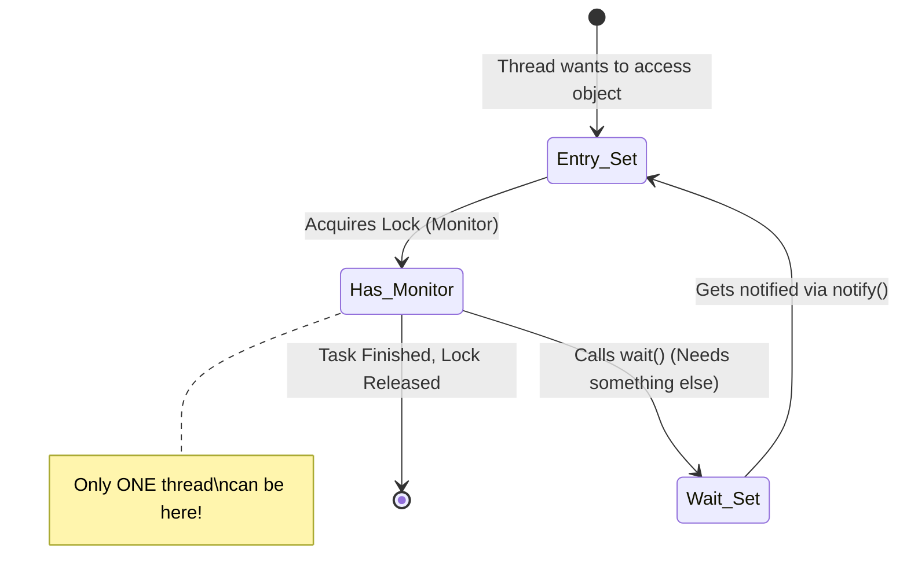

# Java Monitors in Multithreading: A Beginner's Guide


## 1. The Real-World Analogy: The Single ATM Machine 🏧

Imagine a small bank branch that has exactly **one ATM machine** inside a room with a lockable door. 

*   **The ATM Room:** This is your Java **Object** (it holds data, like an account balance).
*   **The Customers:** These are the **Threads** (different parts of your program running at the same time).
*   **The Door Lock & Key:** This is the **Monitor**.

If Customer A (Thread 1) wants to use the ATM, they walk in, close the door, and **lock it**. They now have the "Monitor." 
If Customer B (Thread 2) arrives, they cannot get in. They must wait outside in a line until Customer A finishes, unlocks the door, and leaves. 

In Java, **every single object you create has a built-in Monitor (lock)**. 

## 2. Why do we need Monitors? (The Race Condition)

If we didn't have a lock on the ATM door, Customer A and Customer B might try to press the ATM buttons at the exact same time. They might both see a balance of $100, both withdraw $100, and the bank loses money!

When multiple threads change the same data at the same time and cause errors, it is called a **Race Condition**. Monitors prevent this by enforcing **Mutual Exclusion** (only one thread can execute the code at a time).

## 3. Visualizing the Monitor

Here is a diagram showing how threads interact with an object's Monitor:



*   **Entry Set:** The line of threads waiting outside the ATM room.
*   **Wait Set:** A special waiting lounge. If a thread gets inside but realizes it's missing something (e.g., waiting for a deposit to clear), it steps into the Wait Set and gives up the lock so someone else can use the ATM.

## 4. How to use Monitors in Code: The `synchronized` keyword

In Java, you don't manually write "grab the monitor". Instead, you use the magic keyword `synchronized`.

Here is a simple example. Two threads are trying to book the very last movie ticket.

```java
class MovieTheater {
    int availableTickets = 1;

    // The 'synchronized' keyword tells Java to use this object's Monitor!
    public synchronized void bookTicket(String customerName) {
        System.out.println(customerName + " is checking ticket availability...");
        
        if (availableTickets > 0) {
            System.out.println(customerName + " sees a ticket is available. Booking now...");
            
            // Simulating the time it takes to print the ticket
            try { Thread.sleep(1000); } catch(InterruptedException e) {} 
            
            availableTickets--; // Reduce ticket count
            System.out.println(customerName + " successfully booked the ticket!");
        } else {
            System.out.println("Sorry " + customerName + ", sold out!");
        }
    }
}

public class Main {
    public static void main(String[] args) {
        MovieTheater theater = new MovieTheater(); // Our shared object

        // Thread 1 (Alice)
        Thread t1 = new Thread(() -> {
            theater.bookTicket("Alice");
        });

        // Thread 2 (Bob)
        Thread t2 = new Thread(() -> {
            theater.bookTicket("Bob");
        });

        // Both try to book at the exact same time!
        t1.start();
        t2.start();
    }
}
```

### What happens when you run this?
Because of `synchronized`, Alice will enter the method and lock the `theater` monitor. Bob must wait. Alice books the ticket and leaves. The monitor is unlocked. Bob enters, sees `availableTickets` is now `0`, and gets the "sold out" message. 

*(If you remove `synchronized`, both Alice and Bob might successfully book the single ticket, causing a huge system error!)*

## 5. Related Topics to Explore Next

Now that you understand the basics of Monitors, here are the next topics a Java beginner should explore:

1.  **Synchronized Blocks:** Sometimes locking an entire method is too slow. You can lock just a specific block of code using `synchronized(this) { ... }`.
2.  **wait() and notify():** These are methods used for threads to talk to each other. One thread can `wait()` in the Monitor's Wait Set until another thread calls `notify()` to wake it up.
3.  **Deadlock:** A bug where Thread A holds Lock 1 and waits for Lock 2, while Thread B holds Lock 2 and waits for Lock 1. They stare at each other forever, and your program freezes.
4.  **Volatile Keyword:** Another way to handle multithreading when you only need to make sure threads are reading the most up-to-date value of a variable, without needing a full Monitor lock.